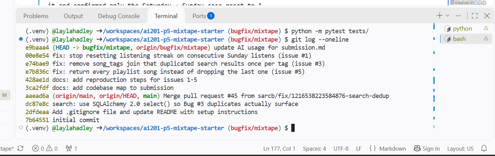

# Mixtape Bug Hunt — Submission

**Branch:** `bugfix/mixtape`

---

## Codebase Map

### Overview

Mixtape is a Flask JSON API backed by SQLite through Flask-SQLAlchemy. It has no HTML frontend; every endpoint returns JSON. The code is split into three layers: **models** (database schema), **routes** (HTTP endpoints), and **services** (business logic).

### Main files and their roles

**`app.py`** — Application factory. `create_app()` builds the Flask app, sets the database URI (defaults to `sqlite:///mixtape.db`, overridable with the `DATABASE_URL` environment variable), initializes the shared `db = SQLAlchemy()` object, registers the four route blueprints under URL prefixes (`/songs`, `/playlists`, `/users`, `/feed`), and calls `db.create_all()` to create tables. The app must be started with `FLASK_APP=app:create_app flask run`; running `python app.py` directly imports the module twice and creates two separate `db` objects.

**`models.py`** — Defines 7 SQLAlchemy models and 3 association tables. Every primary key is a UUID string generated by `generate_uuid()`, and every timestamp defaults to the current UTC time.
- `User` — username, email, `listening_streak` (int), and `last_listened_at` (datetime). Has relationships to the user's shared songs, ratings, listening events, notifications, playlists, and friends.
- `Tag` — a unique tag name such as "rap" or "lo-fi".
- `Song` — title, artist, album, genre, `shared_by` (the user who shared it), `shared_at`, and an optional `share_note`. Its `tags` relationship goes through `song_tags`.
- `ListeningEvent` — one row per play: which user listened to which song and when (`listened_at`).
- `Rating` — a 1–5 `score` from one user for one song. A `UniqueConstraint` on (`user_id`, `song_id`) means each user can hold only one rating per song.
- `Playlist` — name, `created_by`, `created_at`, and `is_collaborative` (defaults to True). Its `songs` relationship goes through `playlist_entries`.
- `Notification` — recipient `user_id`, a `notification_type` string, a human-readable `body`, `created_at`, and a `read` flag.
- Association tables: `friendships` (user ↔ user, stored as two rows per friendship so it works in both directions), `song_tags` (song ↔ tag), and `playlist_entries` (playlist ↔ song). `playlist_entries` also stores `position`, `added_by`, and `added_at`, so playlist songs have an explicit order and a record of who added each one.
- Each model has a `to_dict()` method that converts it into the JSON shape the API returns. `Song.to_dict()` includes a `tags` list of tag names.

**`routes/`** — Four Flask blueprints. Each route reads the URL, query string, or JSON body, checks that required fields are present (returning 400 if not), calls one service function, and wraps the result in `jsonify()`.
- `songs.py` — `GET /songs/search?q=`, `GET /songs/<id>`, `POST /songs/<id>/rate`, `POST /songs/<id>/listen`.
- `playlists.py` — `POST /playlists/`, `GET /playlists/<id>`, `GET /playlists/<id>/songs`, `POST /playlists/<id>/songs`.
- `users.py` — `GET /users/<id>`, `GET /users/<id>/streak`, `GET /users/<id>/notifications` (with optional `?unread_only=true`), `POST /users/notifications/<id>/read`. This is the only route file that queries a model directly (`get_user` looks up `User` without a service).
- `feed.py` — `GET /feed/<id>/listening-now` and `GET /feed/<id>/activity`.

**`services/`** — All business logic lives here.
- `streak_service.py` — `record_listening_event()` saves a `ListeningEvent` and calls `update_listening_streak()`, which compares the calendar date of the new listen to `user.last_listened_at` to decide whether the streak stays the same (same day), increases (consecutive day), or restarts at 1. `get_streak()` returns the stored value.
- `feed_service.py` — `get_friends_listening_now()` collects the user's friend IDs, queries their listening events newer than a cutoff time, sorts newest first, and keeps only the most recent event per friend. `get_activity_feed()` returns the latest N friend listening events with no time cutoff (default 20).
- `search_service.py` — `search_songs()` runs a case-insensitive `ILIKE` match against song title and artist, joined with the `song_tags` table. `get_song()` fetches one song by ID.
- `notification_service.py` — `create_notification()` is the single helper that inserts and commits a `Notification`. This file also owns two user actions that can involve notifications: `add_to_playlist()` and `rate_song()`. `get_notifications()` and `mark_as_read()` handle retrieval and read status.
- `playlist_service.py` — `create_playlist()`, `get_playlist()` (metadata only), `get_user_playlists()`, and `get_playlist_songs()`, which joins `Song` to `playlist_entries` and orders the results by `position`.

**`seed_data.py`** — Drops and recreates all tables, then inserts 5 users (nova, darius, simone, kenji, aaliya) with friendships and starting streaks, 10 tags, 25 songs with 0, 1, or 3+ tags each, 3 playlists, two weeks of listening events, and some existing playlist-add notifications.

**`tests/`** — Pytest suites for streaks, search, and playlists. Each builds its own app and in-memory data through fixtures.

### Data flow: a friend adds a song to a playlist

1. The client sends `POST /playlists/<playlist_id>/songs` with JSON `{"song_id": ..., "added_by": ...}`.
2. `add_song()` in `routes/playlists.py` checks both fields are present (400 if not) and calls `add_to_playlist(playlist_id, song_id, added_by)`. This function lives in `services/notification_service.py`, not `playlist_service.py`, because adding a song can trigger a notification.
3. `add_to_playlist()` loads the `Song`, the adding `User`, and the `Playlist` with `db.session.get()`. If any is missing it raises `ValueError`, which the route turns into a 400 response.
4. If the song isn't already in `playlist.songs`, it appends the song and commits, which writes a row to `playlist_entries`.
5. It compares `song.shared_by` with `added_by_user_id`. If a different person added the song, it calls `create_notification()` with the sharer as recipient, type `song_added_to_playlist`, and a body like "kenji added your song 'X' to the playlist 'Y'."
6. `create_notification()` builds a `Notification` row and commits it.
7. Later, the sharer calls `GET /users/<their_id>/notifications`. `notifications()` in `routes/users.py` calls `get_notifications()`, which queries `Notification` by `user_id`, sorts newest first, and returns each one through `to_dict()`.

### Data flow: a user rates a song

`POST /songs/<song_id>/rate` with `{"user_id": ..., "score": ...}` → `rate()` in `routes/songs.py` converts `score` to an int and calls `rate_song()` in `services/notification_service.py`. `rate_song()` checks the score is between 1 and 5, loads the `Song` and the rating `User`, then looks for an existing `Rating` from that user for that song. If one exists it updates the score; otherwise it creates a new `Rating`. It commits and returns the rating, which the route serializes with `to_dict()` and returns with status 201.

### Patterns I noticed

- **Routes are thin; services hold the logic.** Routes only parse input and format output. Every rule (who gets notified, how streaks count, how songs are ordered) lives in `services/`.
- **Errors travel as `ValueError`.** Services raise `ValueError` for missing records or bad input; routes catch it and return 404 (lookups) or 400 (actions).
- **Services are grouped by side effect, not only by model.** Actions that may create notifications (`add_to_playlist`, `rate_song`) live in `notification_service.py`, even though they mainly change playlists and ratings.
- **Many-to-many data is stored in association tables**, so queries that touch tags, playlists, or friends go through a join.
- **All times are stored in UTC.** Day-based logic (streaks, "today") depends on how those UTC timestamps are converted to dates.

---

## Root Cause Analyses

### **Issue #1 — My listening streak keeps resetting**

**Reproduction steps**
The streak logic reads the real clock, and today isn't Sunday, so I called `update_listening_streak()` in `services/streak_service.py` directly with chosen dates. I gave an in-memory `User` a streak of 12 and a last listen on Saturday Nov 21, 2026 at 22:00 UTC, then a new listen on Sunday Nov 22 at 09:00 UTC. As controls, I ran the same one-day gap for Sunday → Monday and Monday → Tuesday.
- Saturday → Sunday: streak went 12 → **1** (expected 13)
- Sunday → Monday: 12 → 13 (correct)
- Monday → Tuesday: 12 → 13 (correct)

The gap is identical in all three cases; only a listen that lands on a Sunday resets the streak. The existing test `test_streak_increments_on_sunday` also fails.

**Navigation strategy (how I found the root cause)**
I started from the endpoint in the bug report, `GET /users/<id>/streak`. `streak()` in `routes/users.py` calls `get_streak()` in `services/streak_service.py`, and `get_streak()` only reads the stored `user.listening_streak`. That told me the wrong value was saved when the listen happened, not computed when it was read, so I needed to find where the streak is written. I searched for `listening_streak` across `services/` and `routes/`: every write is in `update_listening_streak()`, which `record_listening_event()` calls from `POST /songs/<id>/listen`. Reading `update_listening_streak()`, I checked that `days_since_last` is computed from calendar dates, so Saturday → Sunday correctly gives 1. That ruled out the date arithmetic. The confident moment was the increment branch: `elif days_since_last == 1 and today.weekday() != 6`. I asked AI how `weekday()` and `isoweekday()` number the days, then verified it myself in Python: for Sunday Nov 22, 2026, `weekday()` returns 6 (and `isoweekday()` returns 7). So the condition is false exactly on Sundays, which matched my reproduction where only the Saturday → Sunday case reset.

**Root cause**
In `update_listening_streak()`, a streak should increase whenever the new listen is exactly one calendar day after the last one (`days_since_last == 1`). But the increment branch also required `today.weekday() != 6`. Python's `datetime.weekday()` numbers Monday as 0 and Sunday as 6, so on any Sunday that second condition is false. A consecutive-day listen landing on a Sunday therefore skipped the increment branch and fell into the `else` branch meant for skipped days, which sets `listening_streak = 1`. That is why kenji's streak went from 12 to 1 on Sunday morning even though he had listened Saturday, why it happened only on Sundays, and why Monday's listen counted normally again (12 → 1 → 2). Both the module docstring and the function's own rules define a streak as listening on consecutive calendar days, with no exception for any day of the week. `days_since_last == 1` already fully captures "listened yesterday," so correct behavior requires no weekday check at all; the extra condition added a rule the streak definition never had.

**Fix**
I removed `and today.weekday() != 6` from the increment branch, so it now reads `elif days_since_last == 1:`. The same-day branch (`days_since_last == 0`) and the reset branch (`else`) are unchanged.

**Side-effect check**
I called `update_listening_streak()` with fixed dates on both sides of the boundary, starting each case from a streak of 12:
- Saturday → Sunday (consecutive): 12 → 13. This is the reported case, now fixed.
- Sunday → Monday (consecutive): 12 → 13. Ordinary weekdays are unaffected.
- **Friday → Sunday (skipped Saturday): 12 → 1.** This was the check most likely to reveal a problem. Removing a condition from the increment branch could have let streaks grow when they shouldn't. It confirms a real missed day still resets the streak, even on a Sunday, because a two-day gap never satisfies `days_since_last == 1`.
- Sunday → Sunday (two listens on the same day): 12 → 12. The same-day branch still prevents double-counting.

The full test suite passes (13 tests), including `test_streak_increments_on_sunday`, `test_streak_resets_after_skipped_day`, and `test_streak_does_not_double_count_same_day`.

---

---

### **Issue #3 — The same song keeps showing up twice in search**

**Reproduction steps**
After a fresh `python seed_data.py`, I ran `GET /songs/search?q=Anthem`. The response had `count: 3`: Crown Heights Anthem three times with the same song ID. I then searched for songs with different numbers of tags:
- "Harlem" (Harlem Renaissance, 3 tags) → 3 copies
- "Golden" (Golden Hour, 1 tag) → 1 result
- "Midnight" (Midnight Drive, 0 tags) → 1 result

The number of duplicate copies always equals the song's number of tags, and songs with 0 or 1 tag appear once. The test `test_search_no_duplicates_multi_tag_song` also fails.

**Navigation strategy (how I found the root cause)**
I traced top-down from the endpoint. `search()` in `routes/songs.py` passes the query string to `search_songs()` and returns `len(results)` as the count without modifying the list, so the duplicates were coming from the service. In `search_songs()` in `services/search_service.py`, the filter only compares `Song.title` and `Song.artist`, yet the query also does `.outerjoin(song_tags, Song.id == song_tags.c.song_id)`. My reproduction showed the number of copies always equaled the song's number of tags, and this join is the only place tags enter the query, so it became my hypothesis. To confirm where the `tags` field in the output comes from, I opened `models.py`: `Song.tags` is a relationship through `song_tags`, and `Song.to_dict()` builds the list from `self.tags`, not from the joined rows. The confident moment was running the same query two ways in a Python shell: with the join, "Anthem" returned 3 rows; without it, 1 row, and that song's tags still loaded through the relationship.

**Root cause**
A SQL join returns one row for every matching pair. `search_songs()` outer-joins each matching `Song` to the `song_tags` association table, so a song with three tags matches three `song_tags` rows and produces three result rows. `.scalars().all()` turns each row into a `Song` object, and a plain `select(Song)` in SQLAlchemy 2.0 does not remove duplicate entities, so "Crown Heights Anthem" (tags: rap, hip-hop, boom bap) came back three times. A song with one tag produced one row, and a song with zero tags also produced exactly one row, because an *outer* join keeps unmatched rows with empty tag columns. That is why only multi-tag songs were duplicated. Nothing in the query reads the joined tag columns: the filter uses only title and artist, and the tags shown in each result are loaded separately through the `Song.tags` relationship in `to_dict()`. So the join added rows without adding information. The correct behavior, one result per song, requires a query whose rows correspond to songs rather than song–tag pairs.

**Fix**
I removed the `.outerjoin(song_tags, Song.id == song_tags.c.song_id)` line from `search_songs()`, so the query selects from `Song` alone and returns one row per matching song. I considered adding `.distinct()` instead, but that would only hide the duplicates while keeping a join nothing uses; removing the join removes the cause.

**Side-effect check**
- **Tags still appear:** searching "Anthem" returns one result that still lists all three tags. This was the most plausible thing to break, since a join on tags was removed; it didn't, because the tags were never coming from the join.
- **Zero-tag songs still appear:** "Midnight" (Midnight Drive, 0 tags) still returns 1 result. Before the fix, the *outer* join was what kept untagged songs in the results; I checked that a query with no join doesn't lose them.
- **Artist matching still works:** "Elara" returns both Elara Moon songs (Still Waters and Soft Landing), once each, confirming the title/artist `or_` filter was untouched.
- **Tests:** all 5 tests in `tests/test_search.py` pass, including the single-tag, multi-tag, and no-tag duplicate tests.
---

### **Issue #5 — The last song in a playlist never shows up**

**Reproduction steps**
After a fresh seed, I queried the `playlist_entries` table for "Friday Energy": 7 rows, positions 1–7, with Harlem Renaissance at position 7. `GET /playlists/<friday_energy_id>/songs` returned `count: 6`, missing Harlem Renaissance. I then inserted After Hours at position 8 (added by simone) and called the endpoint again: `count: 7`, Harlem Renaissance now appeared, and After Hours was missing. The endpoint always omits whichever song has the highest position. The test `test_playlist_returns_all_songs` also fails (returns 4 of 5 songs).

**Navigation strategy (how I found the root cause)**
I started at the route instead of jumping to a service. `get_songs()` in `routes/playlists.py` calls `get_playlist_songs(playlist_id)` and returns `"count": len(songs)` with no filtering, so the list was already short when it came back from the service. Next I opened `get_playlist_songs()` in `services/playlist_service.py`. Its query joins `playlist_entries`, filters by `playlist_id`, orders by `position` ascending, and calls `.all()`. During reproduction, my direct query of the same table with the same filter returned all 7 rows, so I reasoned the query itself was fine and the songs were being lost after it. The confident moment was the return line: `[song.to_dict() for song in songs[:-1]]`. Before changing anything, I confirmed the theory by calling the function on an in-memory playlist holding exactly one song: it returned an empty list. I also searched for every caller of `get_playlist_songs` (the route, an unused import inside `add_to_playlist()`, and the tests) to know what the fix could affect.

**Root cause**
`get_playlist_songs()` builds the correct, complete list of songs ordered by `playlist_entries.position` ascending, then returns `songs[:-1]`. In Python, the slice `[:-1]` means "every element except the last one." Because the list is sorted ascending by position, and a newly added song always gets the highest position, the dropped element is always the most recently added song. That explains darius's "weirder" observation: when simone added a song, it took over the last slot, so the previously hidden song moved back into range and her new song became the hidden one. The same slice made a one-song playlist return nothing. The function's own docstring says it "returns all songs in the playlist," and nothing in the app needs the list trimmed, so the correct behavior is to return the full list.

**Fix**
In `services/playlist_service.py`, I changed the return line from `songs[:-1]` to `songs`, so every row the query returns is serialized. This was a one-line change; the query, ordering, and route were already correct.

**Side-effect check**
- **Ordering:** `GET /playlists/<friday_energy_id>/songs` now returns every song in position order with the newest song last. Removing the slice could only change how many songs come back, not their order, and this confirmed it.
- **Both sides of the boundary:** I re-ran my in-memory check. An empty playlist still returns `[]` (an empty list sliced or not is still empty) and a one-song playlist now returns that song instead of nothing.
- **Other callers:** `get_playlist_songs` is also imported inside `add_to_playlist()` in `services/notification_service.py`, but that function never calls it, so playlist-add notifications cannot be affected.
- **Tests:** all 3 tests in `tests/test_playlists.py` pass, including `test_playlist_returns_songs_in_order` and `test_empty_playlist_returns_empty_list`.

---

## AI Usage

I used Claude as a collaborator throughout setup, codebase orientation, reproduction, and debugging. Claude read my fork directly, explained code and Python behavior, and drafted much of the written text in this document from the results I produced. Claude could not run the app itself, so every output below was checked by running the code myself in GitHub Codespaces, and several of its predictions turned out incomplete or wrong.

**Setup (environment debugging)**
- My Windows laptop's Device Guard policy blocked `pip.exe`. Claude explained that `python.exe` was still allowed and suggested `python -m pip` instead, which worked.
- The next error was a blocked SQLAlchemy compiled extension (`_immutabledict_cy`). Claude suggested the `DISABLE_SQLALCHEMY_CEXT_RUNTIME` environment variable. **This only partly worked:** it got past that file but failed on another compiled file (`_result_cy`). We decided patching around the security policy file by file wasn't sustainable and moved the whole project to GitHub Codespaces, where the original setup commands worked.

**Codebase orientation**
- I gave Claude read access to my fork and asked it to summarize each file's responsibility and trace one feature end to end. It traced the add-to-playlist → notification flow (`routes/playlists.py` → `add_to_playlist()` in `notification_service.py` → `create_notification()` → `get_notifications()`). It also pointed out that `add_to_playlist()` and `rate_song()` live in `notification_service.py` rather than the playlist or song services. Claude drafted the codebase map from this; I checked each file description against the source before committing it.

**Hypotheses before reading code**
- Before seeing the code, I asked Claude to form hypotheses from the five issue reports alone. Two matched what we later found: an off-by-one for Issue #5 and a database JOIN without de-duplication for Issue #3. **The Issue #1 hypothesis was wrong in its mechanism:** Claude guessed that the code did arithmetic on day-of-week numbers (for example Sunday = 0 minus 1 not matching Saturday = 6). The actual code computed the day gap correctly and instead had an explicit `today.weekday() != 6` condition. This showed me why the assignment says to read the code before trusting a diagnosis.

**Reproduction**
- Issue #1 only happens on Sundays and the code reads the real clock. Claude suggested calling `update_listening_streak()` directly with fixed Saturday/Sunday dates instead of waiting for a Sunday. I ran it and confirmed only the Saturday → Sunday case reset to 1.
- Claude noticed the seed data hides Issue #2 (each seeded friend also has a listen from the last 20 minutes, which outranks older listens) and wrote an in-memory test with a single 11:59 PM listen. I ran it and saw yesterday's listener appear.
- Claude predicted three specific failing tests. **The actual run showed four:** `test_playlist_returns_songs_in_order` also failed. I traced it to the same Issue #5 behavior (the list stopped at Track 4, so the order check failed too).

**Debugging**
- **Issue #1:** After I found the `today.weekday() != 6` condition, I asked Claude how `weekday()` and `isoweekday()` number the days. It explained that `weekday()` uses Monday = 0 to Sunday = 6 and `isoweekday()` uses Monday = 1 to Sunday = 7. I verified it in Python: Sunday Nov 22, 2026 gives `weekday()` = 6 and `isoweekday()` = 7.
- **Issue #3:** Claude suggested running the search query with and without the `song_tags` join. I ran both: 3 rows with the join, 1 without, and the song's tags still loaded through the `Song.tags` relationship. That confirmed the join could be removed instead of hidden with `.distinct()`.
- **Issue #5:** Claude suggested testing a one-song playlist before fixing. It returned an empty list, which confirmed the `songs[:-1]` slice theory, and after the fix I re-ran it to check both sides of the boundary.

**Writing**
- Claude drafted the root cause analysis entries from my reproduction results and the code we traced together. I checked every number and claim against my own terminal output and the source files, and edited wording where it didn't match what I saw.

---

---

## Commit History

